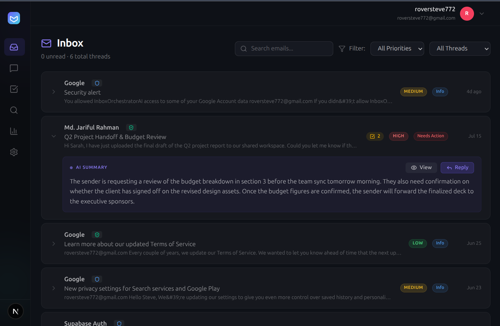
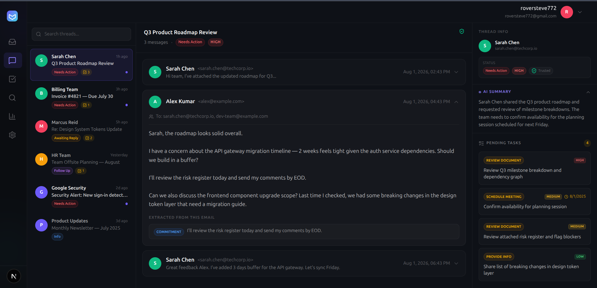
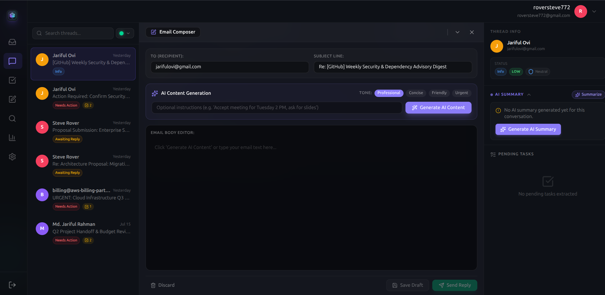
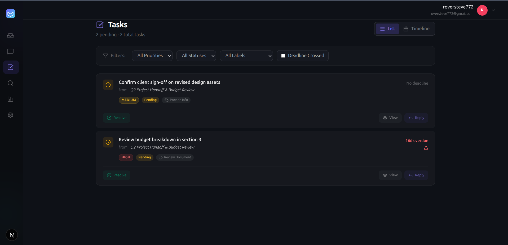
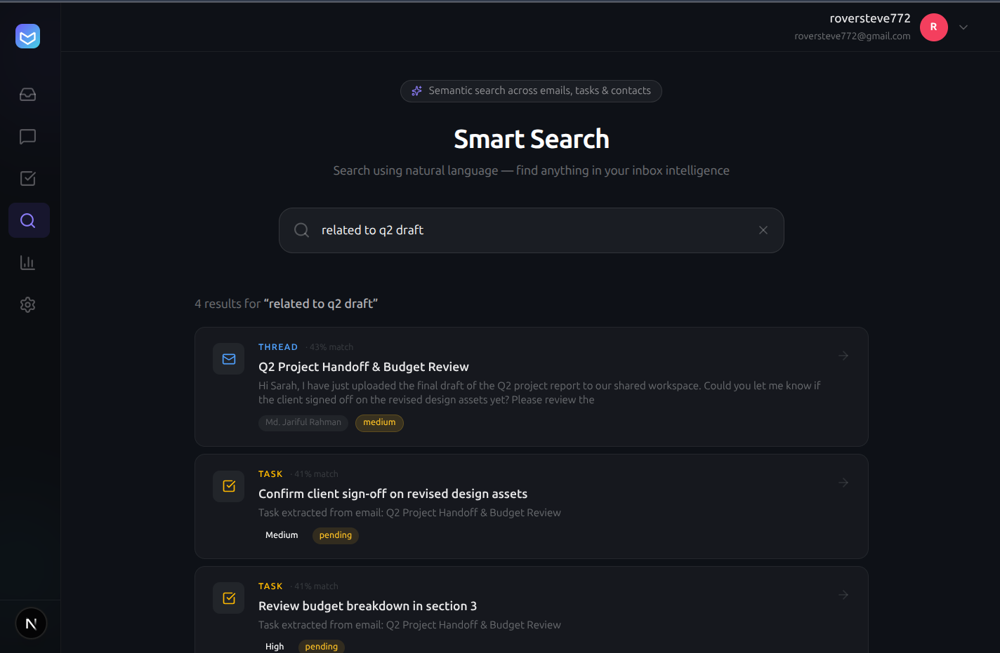
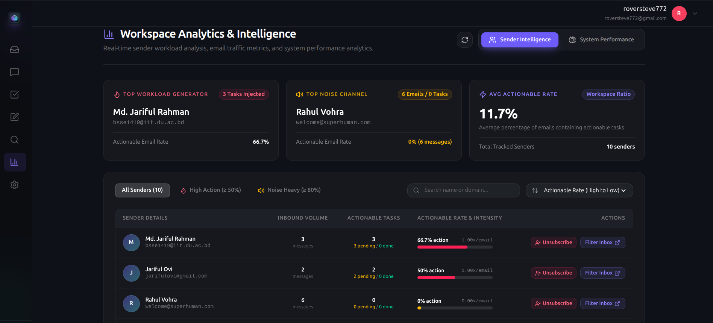
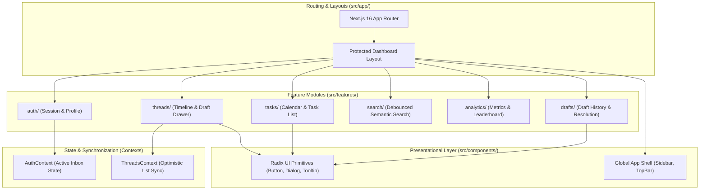

# 🖥️ InboxOrchestrator AI — Modern Web Client

> Executive Next.js 16 frontend interface for autonomous email orchestration, AI-assisted draft composition, SLA lifecycle tracking, and semantic knowledge retrieval.

---

## 📸 Visual Showcase & Core Interfaces

### 1. Unified Inbox Triaging
Consolidated workspace displaying conversation threads across connected accounts with real-time SLA status badges, priority levels, and category segmentation.



* **Category Tabs:** Instant switching between `Focused` (Work/Financial), `All Threads`, `Noise` (Newsletters/System Alerts), and `Sent`.
* **SLA Lifecycle Indicators:** Color-coded badges for `Needs Action`, `Awaiting Reply`, `Follow Up` (>48h overdue), `Informational`, and `Archived`.
* **Quick Triaging:** Inline read/unread toggles and one-click thread archiving.

---

### 2. Deep Conversation Timeline & Context Inspector
Full chronological message viewer with sanitized email rendering, security trust verification, and AI-generated thread summaries.



* **Executive Summary Card:** 3–5 sentence contextual overview generated by Gemini LLM, with on-demand re-summarization.
* **Security & Trust Headers:** Real-time SPF/DKIM verification badges to detect spoofed senders.
* **Extracted Action Facts:** Displays extracted commitments, temporal references, and pending tasks directly linked to each message node.

---

### 3. AI Draft Composer & Task Resolution
Slide-over drawer for composing replies with contextual AI assistance and automated task resolution tracking.



* **Contextual AI Generation:** Generates grounded reply drafts using thread history, user directives, and tone controls (`Professional`, `Concise`, `Friendly`, `Urgent`).
* **Task Resolution Associations:** Checkboxes allow users to select which pending tasks are resolved upon sending the email, recording an audit trail in `email_draft_resolutions`.
* **Direct Gmail Synchronization:** Synchronizes drafts directly with the native Gmail Drafts API.

---

### 4. Task Action Center & Calendar Grid
Interactive execution layer visualizing commitments, action items, and temporal deadlines extracted from emails.



* **Dual View:** Instant toggle between a filtered list view and a monthly calendar grid.
* **Intent Categorization:** Color-coded task chips for `Schedule Meeting`, `Review Document`, `Make Payment`, and `Follow Up`.
* **1-Click Google Calendar Sync:** Direct export of any pending commitment to Google Calendar with deep-links back to the source email.

---

### 5. Smart Semantic Vector Search
Natural language query interface powered by 384-dimensional vector similarity search.



* **Hybrid Matching:** Natural language semantic search running against Supabase `pgvector` with relevance score indicators.
* **Contact Intelligence:** Automatically surfaces unique senders and CC/BCC recipients related to search query results.

---

### 6. Sender Intelligence & Workspace Analytics
Comprehensive metrics on communication volume, workload intensity, and operational response rates.



* **Action vs. Noise Ratios:** Identifies high-demand contacts vs. high-volume automated channels.
* **SLA Breach Monitoring:** Tracks overdue response times and workspace-wide task completion velocity.

---

## 🏛️ Frontend Architecture & Design Principles

The frontend is built with a focus on modularity, performance, and maintainability using **Feature-Sliced Design (FSD)**:



### 1. Feature-Sliced Module Isolation (`src/features/`)
Every business domain lives in an isolated folder under `src/features/` co-locating:
* Feature-specific UI components (`components/`)
* Domain data-fetching hooks (`use-threads.ts`, `use-tasks.ts`, `use-draft-composer.ts`)
* Feature contexts and utilities (`types.ts`, `utils.ts`)

### 2. Lightweight State Management (Zero Over-Engineering)
Avoids complex global state machines (no Redux or Zustand bloat). Global state is restricted strictly to two lightweight React Contexts:
* **`AuthContext` (`src/features/auth/auth-context.tsx`)**: Manages the current authenticated user and the active connected email account (`selectedAccount`), triggering view re-fetches when switching mailboxes.
* **`ThreadsContext` (`src/features/threads/threads-context.tsx`)**: Coordinates cross-panel state between the detail thread timeline and the left-hand navigation list, providing instant optimistic updates (e.g., status badge changes) without reloading.

### 3. In-Memory Token Security & Axios Interceptors
* JWT tokens from Supabase Auth are held in-memory (`lib/auth-token.ts`) to mitigate XSS attack vectors.
* An Axios request interceptor (`lib/axios.ts`) automatically injects the `Authorization: Bearer <token>` header into all outbound API requests.

### 4. HTML Email Sanitization
Emails contain complex, unpredictable HTML and tracking scripts. All incoming message bodies pass through a hardened `DOMPurify` pipeline (`lib/sanitize.ts`) to sanitize malicious payloads while preserving layout styling.

---

## 🧭 Core User Workflows

1. **Connect Mailbox:** Users authenticate with Google OAuth 2.0 via `/dashboard/settings`, granting minimal required Gmail and Calendar scopes.
2. **Triage Inbox:** The unified inbox automatically organizes incoming communications into `Focused` vs. `Noise` and tags threads with SLA urgency indicators.
3. **Contextual Inspection:** Users click into any thread to view the full message timeline, extracted commitments, and Gemini-generated summaries.
4. **Draft & Resolve:** Users open the draft composer to generate or edit a reply, select which tasks the reply satisfies, and send directly via the Gmail API.
5. **Calendar Export:** Actionable tasks are exported into Google Calendar with a single click from the list or calendar grid.

> 📖 **Full Operations Guide:** For detailed user instructions and configuration steps, see the complete [User Manual](../.agents/user_manual.md).

---

## 📂 Directory Structure

```text
src/
├── app/                              # Next.js App Router
│   ├── (auth)/                       # Login & Registration Pages
│   ├── (oauth)/                      # OAuth Callback Handlers
│   ├── dashboard/                    # Protected Dashboard Routes
│   │   ├── inbox/                    # Unified Inbox Page
│   │   ├── threads/                  # Detail Conversation Timeline
│   │   ├── tasks/                    # Task List & Calendar Grid
│   │   ├── drafts/                   # Account-Wide Drafts & History
│   │   ├── search/                   # Smart Semantic Search
│   │   ├── analytics/                # Workspace Intelligence Dashboard
│   │   └── settings/                 # Mailbox Connections & AI Settings
│   ├── globals.css                   # Tailwind CSS v4 Theme Variables
│   └── layout.tsx                    # Root Layout with AuthProvider
│
├── components/                       # Shared Presentational Primitives
│   ├── shared/                       # Sidebar, TopBar, Loading Spinners
│   └── ui/                           # Radix UI Primitives (Buttons, Dialogs, Tooltips)
│
├── features/                         # Feature-Sliced Business Domains
│   ├── auth/                         # Authentication Context & Profile Services
│   ├── threads/                      # Conversation Timeline & Composer Drawer
│   ├── tasks/                        # Task List, Calendar Grid & Export Handlers
│   ├── drafts/                       # Draft Card Components & Resolution Badges
│   ├── search/                       # Debounced Vector Search Hook & Results
│   ├── analytics/                    # Workload Metric Cards & Leaderboards
│   └── settings/                     # Mailbox Toggle Cards & AI Model Selectors
│
└── lib/                              # Core Utility Singletons
    ├── auth-token.ts                 # In-Memory Token Manager
    ├── axios.ts                      # Configured Axios Client with JWT Interceptors
    ├── sanitize.ts                   # DOMPurify Email HTML Sanitizer
    └── supabase.client.ts            # Supabase JS Client
```

---

## 🧰 Technology Stack

| Layer | Technology |
| :--- | :--- |
| **Framework** | [Next.js 16](https://nextjs.org/) (App Router, Server/Client Hybrid Components) |
| **UI Library** | [React 19](https://react.dev/), [TypeScript](https://www.typescriptlang.org/) |
| **Styling** | [Tailwind CSS v4](https://tailwindcss.com/), Radix UI Primitives, CSS Custom Properties |
| **Icons** | [Lucide React](https://lucide.dev/) |
| **HTTP Client** | [Axios](https://axios-http.com/) with Bearer JWT Interceptors |
| **Sanitization** | [DOMPurify](https://github.com/cure53/DOMPurify) |
| **Notifications** | [Sonner](https://sonner.emilkowal.ski/) |
| **Validation** | [Zod](https://zod.dev/) + [React Hook Form](https://react-hook-form.com/) |

---

## 🚀 Getting Started & Local Development

### 1. Prerequisites
* **Node.js 20+**
* **npm** or **pnpm**
* Running instance of the [InboxOrchestratorAI Backend](../InboxOrchestratorAI)

### 2. Installation
```bash
# Navigate to the frontend directory:
cd inbox-orchestrator-frontend

# Install dependencies:
npm install
```

### 3. Environment Variables
Create a `.env.local` file in `inbox-orchestrator-frontend/`:
```env
NEXT_PUBLIC_BACKEND_URL=http://localhost:8000/api
NEXT_PUBLIC_SUPABASE_URL=https://<your-supabase-ref>.supabase.co
NEXT_PUBLIC_SUPABASE_ANON_KEY=<your-supabase-anon-key>
```

### 4. Run Development Server
```bash
npm run dev
```

Open [http://localhost:3000](http://localhost:3000) to view the application.

### 5. Production Build
```bash
npm run build
npm run start
```